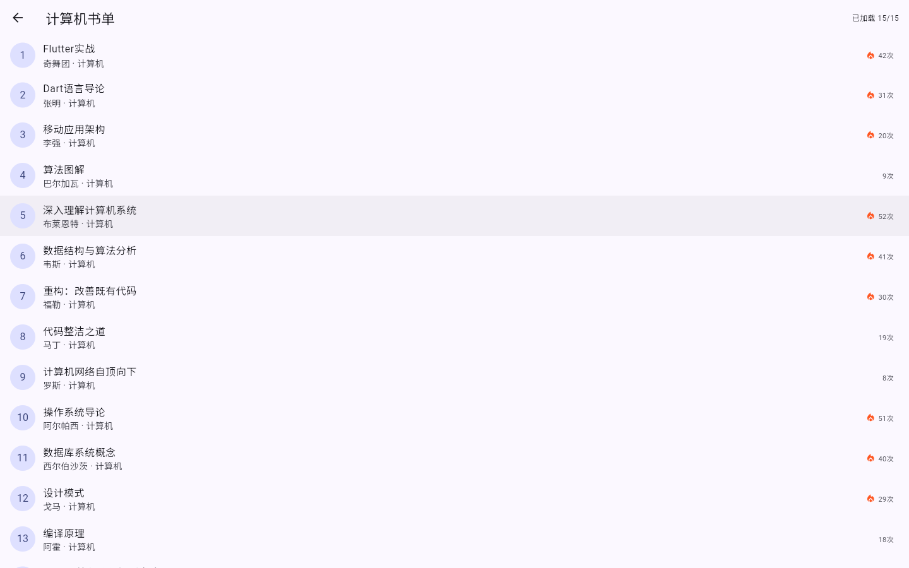
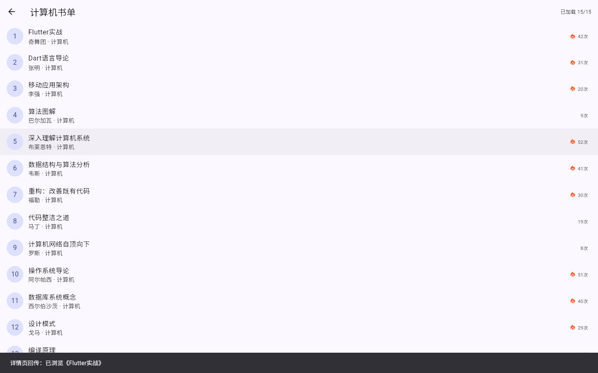
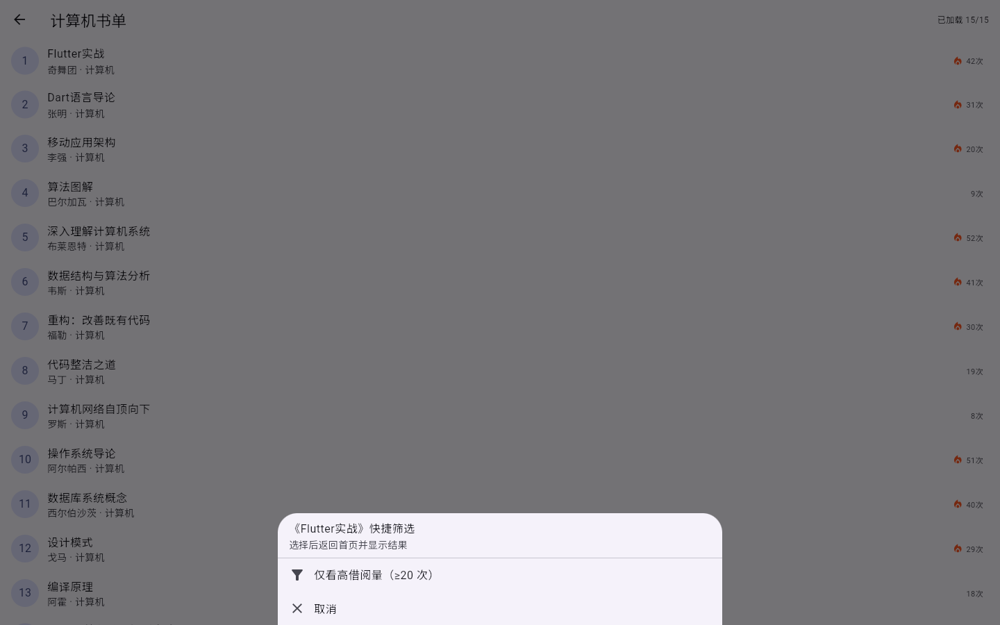
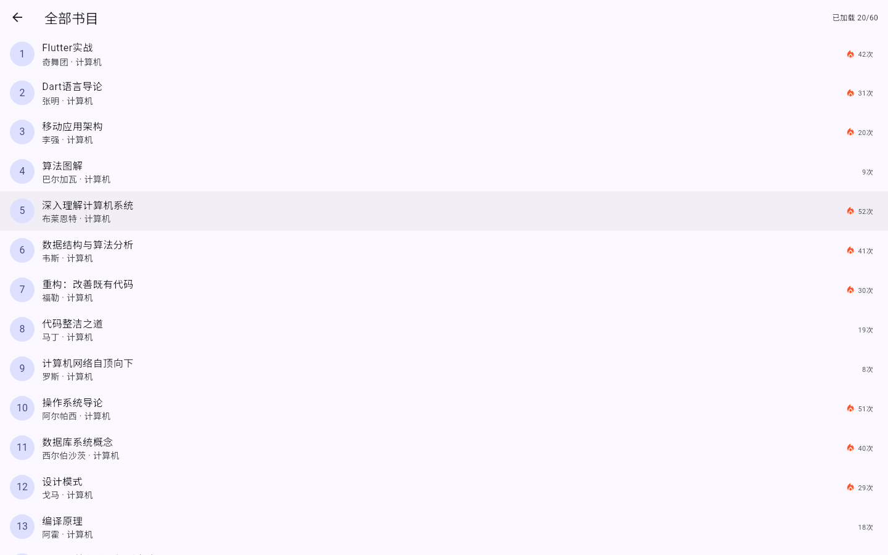
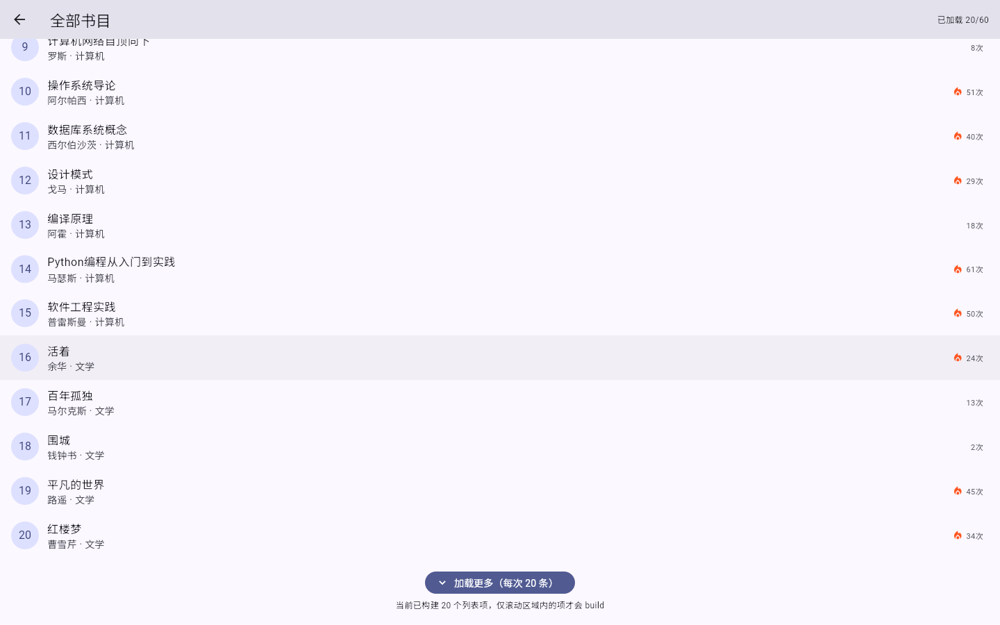
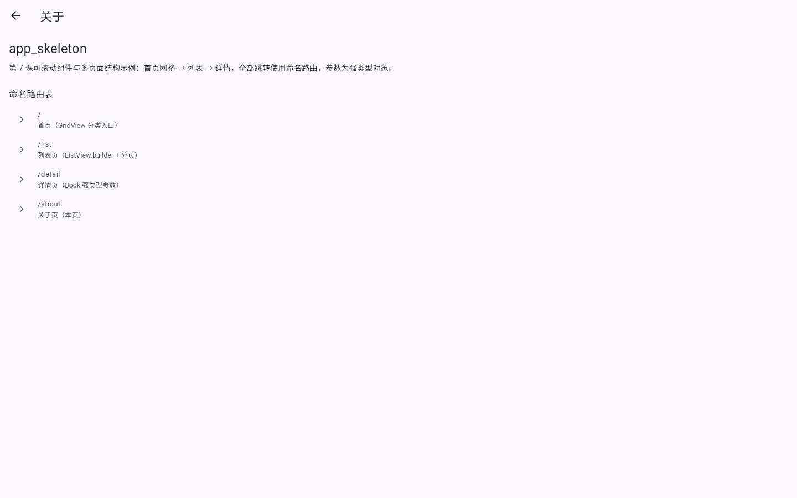
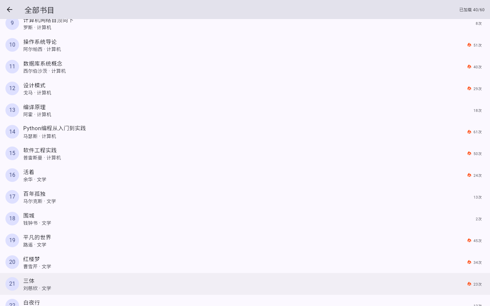

# 进度报告7（第9周·可滚动组件与多页面结构）

> 使用方式：在模板上作答，作答完成后将全文复制到雨课堂答题区（图片无法粘贴时在雨课堂编辑器中手工重新上传），并将同一内容存入自己仓库 lecture7/progress.md。

## 一、任务理解

本次作业要完成的事：

1. 案例复现 app_skeleton：用 flutter create 生成工程，把 Book 模型与 books.json 放进 lib 与 assets，列表页用 ListView.builder 渲染数据；
2. 命名路由与传参：注册不少于 3 条命名路由，列表项携带 Book 实例跳详情页，详情页完整显示字段并用 pop 返回；全工程不使用散落的 MaterialPageRoute；
3. 网格首页与回传值：首页用 GridView 做分类入口，点分类进入列表页并按类别过滤；列表页长按弹层选择“仅看高借阅量”，选择结果 pop 回首页显示在 AppBar 副标题；
4. 课堂作业七的五项要求：列表分页模拟（每次追加 20 条）、命名路由表不少于 4 条、去程强类型模型与回程至少一处生效、抽取至少 2 个参数化复用组件到 widgets/、标注 AI 使用；
5. Git 规范：至少 3 次提交，提交信息带 docs: / feat: 前缀，build/ 目录不入库。

验收标准（对照要求单）：三页跳转闭环（首页→列表→详情→返回）；详情参数正确；回传值生效；分页每次追加 20 条；命名路由不少于 4 条且全部走命名式；widgets/ 下至少 2 个参数化组件；Git 3 次以上规范提交；报告十节完整；能口头解释命名路由与直接 push 的取舍。

## 二、环境与工具

开发环境：Windows + PowerShell；编辑器与 AI 工具：VS Code，Trae（内置 TraeCode AI）。

SDK 与运行目标：Flutter 3.47.4 stable / Dart 3.13.3；运行目标为 Chrome（flutter run -d chrome），静态检查使用 dart analyze（工程位于中文路径，flutter analyze 在本机有已知崩溃问题，沿用第 5 周的规避方案）。

构建与验证工具：flutter build web --release 产物由本地 http.server 提供，用 Playwright 驱动 Chrome（1440×900 桌面窗口）逐页截图取证；flutter test 运行 3 个 Widget 流程测试。

## 三、过程记录

1. 环境自查：flutter --version 确认 3.47.4 stable，dart 3.13.3；git 2.55；
2. flutter create --project-name app_skeleton --platforms=web,windows 生成工程，清理默认计数器模板；
3. 数据层：新建 lib/models/book.dart（字段 id、title、author、category、borrowCount、summary，含 fromJson 工厂）与 assets/books.json（4 个分类共 60 条书目），pubspec 声明 assets → 提交1：`4af52ca feat: book model & bundled book data`；
4. 列表页：ListView.builder 懒构建 + offset/limit 分页，底部“加载更多”每次追加 20 条，AppBar 显示“已加载 x/总数” → 提交2：`8801d67 feat: list page with builder and load-more paging`；
5. 路由与传参：MaterialApp 注册命名路由表，列表项 pushNamed 携带 Book，详情页用 ModalRoute.of(context)!.settings.arguments as Book 接收，底部按钮 pop 带字符串 → 提交3：`470462b feat: named routes & typed arguments`；
6. 网格首页：GridView.builder 分类入口（含“全部书目”），按 ListPageArgs 过滤；列表页长按弹层选择“仅看高借阅量”，结果 pop 回首页显示在 AppBar 副标题 → 提交4：`01e9827 feat: grid home & pop-with-value filter`；
7. 组件抽取：重复的列表项与分类卡片抽成 widgets/book_tile.dart、widgets/category_card.dart，页面代码瘦身 → 提交5：`17638a3 feat: extract book tile & category card widgets`；
8. 静态检查：dart analyze 0 issues；flutter test 3 个用例全部通过（三页闭环、分页追加、长按回传）；
9. 运行验证：flutter build web --release，Playwright 逐页截图（首页、列表、详情、回传、弹层、分页、关于页）；
10. 撰写本报告并存入仓库 lecture7/progress.md（提交6：docs: progress report 7）。

## 四、关键代码

### 1、ListView.builder + 分页追加（AI 对照方案后手写）

```dart
static const int _pageSize = 20;

List<Book> _fetch(int offset) => BookRepository.instance.page(
      category: widget.category,
      onlyPopular: widget.onlyPopular,
      offset: offset,
      limit: _pageSize,
    );

void _loadMore() {
  final next = _fetch(_offset);
  setState(() {
    _items.addAll(next);
    _offset += next.length;
    _hasMore = _offset < _total;
  });
}
```

逐行解释：`_pageSize = 20` 与要求单的“每次追加 20 条”绑定；`_fetch(offset)` 把“取哪一段”交给仓库的 sublist，页面只管累积；`_loadMore` 只在回调里取出下一页，然后一次 setState 里做三件事——追加数据、推进 offset、更新 hasMore。`hasMore` 为 false 时按钮 onPressed 传 null，按钮自动置灰并显示“已加载全部”，避免越界后再点。列表用 builder 而非 children，是因为数据来自 JSON 且会持续追加，builder 只为视口内的项创建 Element。

AI 生成说明：让 AI 对照“children 与 builder 的选型”和分页写法，AI 给出了 offset/limit 方案与 hasMore 判断；本人运行后点击“加载更多”验证 20→40→60（截图7、10）。分页代码按项目实际字段改写，未直接复制。

### 2、命名路由表与强类型参数接收（手写，AI 校对）

```dart
routes: {
  '/': (_) => const HomePage(),
  '/list': (context) {
    final args = ModalRoute.of(context)!.settings.arguments;
    if (args is ListPageArgs) {
      return ListPage(category: args.category, onlyPopular: args.onlyPopular);
    }
    return const ListPage();
  },
  '/detail': (_) => const DetailPage(),
  '/about': (_) => const AboutPage(),
},
```

逐行解释：routes 是“路由名→页面构造器”的映射，四处跳转只认名字，页面地址集中在一处维护；`/list` 的构造器里通过 `ModalRoute.of(context)` 拿到当前路由，再读 `settings.arguments`，用 `is` 判断而不是 `as` 强转，兼容“不带参数直接打开列表”的场景；`/detail` 页则在 build 里 `as Book` 取出强类型对象。命名路由的取舍：地址集中、可统一做路由守卫和埋点，但传参要自己解析、类型安全靠约定；直接 push `MaterialPageRoute` 写起来快、参数直接进构造器编译期检查，但地址散落、难以统一拦截。

AI 生成说明：AI 审阅了路由表写法，提醒“arguments 只能在路由构造器的 context 上取”；本人改为 `is ListPageArgs` 并运行验证三页闭环（截图1、2、3）。

### 3、回程传值：详情页 pop 与列表长按 pop（手写）

```dart
Future<void> _openDetail(Book book) async {
  final result = await Navigator.pushNamed(
    context,
    '/detail',
    arguments: book,
  );
  if (!mounted || result == null) {
    return;
  }
  ScaffoldMessenger.of(context).showSnackBar(
    SnackBar(content: Text('详情页回传：$result')),
  );
}

// 详情页底部按钮
FilledButton.icon(
  onPressed: () => Navigator.pop(context, '已浏览《${book.title}》'),
  icon: const Icon(Icons.reply),
  label: const Text('返回并带回浏览结果'),
)
```

逐行解释：`await pushNamed` 让发起端挂起，等目标页 `pop(context, 值)` 时才恢复，result 就是回程值；`!mounted` 防止页面已销毁还去取 context，`result == null` 过滤掉系统返回键（无值）的情况；SnackBar 用来即时证明“值真的回来了”。列表长按弹层同理：`showModalBottomSheet<String>` 返回选中项，`Navigator.pop(context, choice)` 再把结果回传首页，首页 `_returnedFilter` 显示在 AppBar 副标题，同时把 `_onlyPopular` 置真，下一次进列表自动带上热点筛选。

AI 生成说明：AI 提示“pop 的值要有人接，await 不能漏”；本人按此实现并验证两处回传（截图4、6）。

## 五、检查点结果

| 检查点 | 结果 | 证据说明 |
| --- | --- | --- |
| 三页跳转闭环 | ✅ | 首页网格→计算机书单→详情→返回，全程命名路由；截图1-4 |
| 详情参数正确 | ✅ | 详情页显示 Flutter实战 / 奇舞团 / 计算机 / 借阅42次 / 编号#1，与列表项一致（截图3） |
| 回传值生效 | ✅ | 详情页 pop 后列表底部 SnackBar 显示“详情页回传：已浏览《Flutter实战》”（截图4）；列表长按弹层选择后首页副标题显示“回传：仅看高借阅量（≥20 次）”（截图6） |
| 列表分页模拟 | ✅ | 初始 20/60，点“加载更多”变 40/60，每次追加 20 条；截图7、10 |
| 命名路由表 ≥4 条 | ✅ | `/`、`/list`、`/detail`、`/about` 四条，关于页内列出路由表（截图9） |
| 组件抽取 ≥2 个 | ✅ | widgets/book_tile.dart（入参 book/onTap/onLongPress）、widgets/category_card.dart（入参 label/count/icon/onTap） |
| 静态检查 | ✅ | dart analyze：No issues found |
| 流程测试 | ✅ | flutter test：3 个用例全部通过（闭环、分页、长按回传） |
| 口头解释路由取舍 | ✅ | 见第四节第2段：命名路由集中可拦截，直接 push 编译期安全但地址分散 |
| Git 规范 | ✅ | 5 次 feat 提交 + 1 次 docs 提交，build/ 由 .gitignore 排除 |

## 六、问题与调试

问题1：flutter create 自带的 test/widget_test.dart 引用已删除的 MyApp，dart analyze 直接报 undefined class。定位过程：报错指向 test 目录，确认是模板遗留而不是业务代码。解决方案：删掉模板测试，改写成 3 个真实流程测试；写测试时还发现默认 800×600 画布下第 5 张分类卡片在视口外，点击“全部书目”会失败——用 tester.binding.setSurfaceSize(1200×2000) 固定画布后稳定通过。

问题2：验证回传值时进入“全部书目”，AppBar 显示“已加载 20/43”，而全部数据是 60 条，一度怀疑分页取数少算。定位过程：把 `_total` 的来源 `BookRepository.count(category, onlyPopular)` 与控制台数据对照，发现长按选择后首页把 `_onlyPopular` 置真，之后再进列表就只统计借阅量≥20 的 43 本，20/43 是正确结果。结论：这不是 bug，而是回传值确实改变了后续页面的入参，属于预期行为；保留该实现并作为“回传生效”的证据（截图6）。

问题3：用 Playwright 在 1440×900 的全屏窗口中自动点击“加载更多”时无反应，计数停在 20/60。定位过程：先怀疑按钮被禁用，但 hasMore 为 true；再对照截图量出按钮实际中心在 y≈838，而脚本点击的是 y≈825，落在按钮上边缘之外，属于命中测试偏移。解决方案：修正点击坐标到 838，重跑后计数变为 40/60（截图10）。结论：自动化验证也要以“命中区域”而不是“看起来的位置”为准。

## 七、AI 使用记录

| 序 | 用途 | 指令摘要 | AI 输出 | 本人验证方式 |
| --- | --- | --- | --- | --- |
| 1 | 路由表设计 | 贴出三页结构与 ListPageArgs/Book 模型，问命名路由表如何组织、arguments 在哪里取 | routes 映射与 ModalRoute 取参片段，提醒构造器 context | dart analyze 通过；手工点通三页闭环并截图 |
| 2 | 分页方案 | 给出列表页现状与“每次追加 20 条”要求 | offset/limit + hasMore 方案 | 运行点击“加载更多”，20→40 截图核对 |
| 3 | 组件抽取 | 贴出两处重复的 ListTile 与分类 Card 代码，要求参数化 | 建议入参（book/onTap/onLongPress；label/count/icon/onTap） | 替换后 dart analyze 0 issues、flutter test 3/3 通过 |
| 4 | 截图脚本 | 说明需在 Chrome 中逐页取证，要求给 Playwright 脚本 | Python + Playwright 点击/截图脚本 | 逐张核对截图内容；坐标错误时自行取色修正 |
| 5 | 文档校对 | 贴本报告草稿，要求检查术语与前后一致性 | 文字修改建议 | 按实际运行结果逐条改写，不采用未验证的描述 |

说明：AI 只做方案对照、代码审阅与脚本生成；是否采纳、参数如何落地、结果是否成立，均由本人运行与截图验证。

## 八、证据截图


















命令行证据（dart analyze 与 flutter test）：

```text
Analyzing app_skeleton...
No issues found!

00:00 +0: loading test/app_flow_test.dart
00:00 +1: 首页 → 列表 → 详情 → 回传闭环
00:01 +2: 加载更多每次追加 20 条
00:01 +3: 列表长按弹层，选择结果回传首页副标题
00:01 +3: All tests passed!
```

Git 提交记录：

```text
17638a3 feat: extract book tile & category card widgets
01e9827 feat: grid home & pop-with-value filter
470462b feat: named routes & typed arguments
8801d67 feat: list page with builder and load-more paging
4af52ca feat: book model & bundled book data
# 本报告另以 docs: progress report 7 提交
```

## 九、自评

| 序 | 任务 | 完成情况 |
| --- | --- | --- |
| 1 | 列表分页模拟：builder + 每次追加 20 条 | ✅ 20→40→60，按钮在取完后置灰（截图7、10） |
| 2 | 命名路由表不少于 4 条，全部命名式 | ✅ `/`、`/list`、`/detail`、`/about`，无散落的 MaterialPageRoute |
| 3 | 参数与返回值：去程强类型、回程至少一处生效 | ✅ 去程 ListPageArgs/Book；回程两处：详情页 SnackBar、长按弹层→首页副标题并影响后续筛选 |
| 4 | 组件抽取：至少 2 个参数化复用组件入 widgets/ | ✅ BookTile、CategoryCard |
| 5 | AI 使用标注 | ✅ 第七节清单，含指令摘要与验证方式 |
| 附加 | app_skeleton 完整复现 / 检查点 / Git 规范 / 报告记录 | ✅ 三页闭环；5 次 feat 提交 + 1 次 docs；本报告十节完整 |

## 十、一句话收获与下一步计划

本课最大的收获是：页面不是“堆”出来的，而是被路由表和参数契约串起来的——`pushNamed` 决定去哪，`arguments` 决定看到什么，`pop` 的返回值又能反过来改上一页的状态；ListView.builder 的懒构建则提醒我，“谁在什么时候被创建、谁被销毁”才是滚动与导航背后的主线。

遗留问题：独立研究任务（CustomScrollView + Sliver 同屏滚动、路由守卫、PageRouteBuilder 转场）本次未做；扩展练习 EX6~EX10 的五个缺陷案例也未动手修复。下一步先补 EX8/EX9（去程传参 + 回程带值），再预习第 11 课的数据场景：RefreshIndicator 下拉刷新、上拉加载与异步请求下的分页状态管理。
